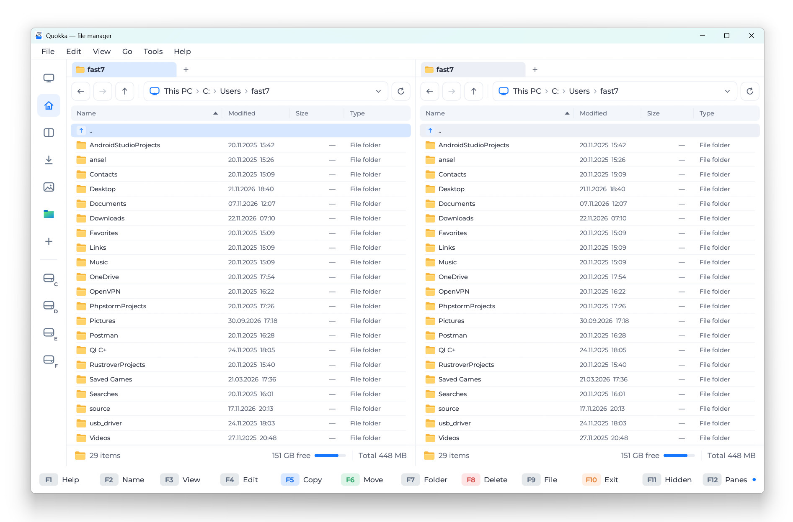

<p align="center">
  
</p>

<h1 align="center">Quokka File Manager</h1>

<p align="center">
  <b>A fast two-pane file manager for Windows — tabs, ZIP, SFTP/FTP, batch rename and image conversion. Written in Rust.</b>
</p>

<p align="center">
  <a href="https://github.com/Natterum/quokka-file-manager/releases/latest"></a>
  <a href="https://github.com/Natterum/quokka-file-manager/releases"></a>
  <a href="https://github.com/Natterum/quokka-file-manager/actions/workflows/windows.yml"></a>
  <a href="LICENSE"></a>
  
  
  <a href="https://github.com/Natterum/quokka-file-manager/stargazers"></a>
</p>

<p align="center">
  <a href="https://github.com/Natterum/quokka-file-manager/releases/latest"><b>⬇️ Download</b></a> ·
  <a href="#features">Features</a> ·
  <a href="#installation">Installation</a> ·
  <a href="#keyboard-shortcuts">Keyboard shortcuts</a>
</p>



A two-pane file manager built with Rust and [egui/eframe](https://github.com/emilk/egui), with F1–F12 keyboard controls, tabs, and background copy, move, and delete operations.

The executable is named `quokka`; the window is titled “Quokka File Manager”.

## Features

### Browsing
- 🪟 **Two panes with tabs** — or one pane, switch with F12.
- 🧭 **Easy navigation** — clickable path bar, back and forward, quick links to Desktop, Downloads, Pictures and your drives in the sidebar.
- 🔍 **Search** — filter the current folder by name (`Ctrl+F`) or find files anywhere, even by the text inside them (`Alt+F7`).
- 📊 **Columns you choose** — name, date, size, type and more; sort by clicking a column.
- 💾 **Remembers your tabs** — everything reopens the next time you start Quokka.

### Looking at files
- ⚡ **Quick view** (`Ctrl+Q`) — the other pane shows the picture or text file under the cursor. Flip through photos with the arrow keys.
- 👁️ **Viewer** (F3) — open pictures and text files without leaving Quokka; zoom in and out.
- 📝 **Edit** — F4 opens your editor (Notepad by default), Shift+F4 a simple built-in one.

### Working with files
- 📁 **Copy, move, delete** — with F5, F6, F8, `Ctrl+C` / `Ctrl+V` or drag and drop, also to and from other programs. Big jobs run in the background, and you can pause or cancel them.
- ↩️ **Undo** (`Ctrl+Z`) — bring back deleted files, undo a move or a rename.
- 🏷️ **Rename many files at once** (`Ctrl+M`) — see the new names before anything changes. [More below](#batch-rename-ctrlm).
- 🖼️ **Convert pictures** (`Ctrl+Shift+E`) — to JPEG, PNG, WebP and other formats, many at once.
- 🗜️ **ZIP archives** — open them like folders and take out what you need; pack files into a new ZIP.
- 📏 **Folder sizes** (`Alt+Enter`) — see how much space each folder takes. [More below](#folder-sizes).
- 🎯 **Select by pattern** — for example, all `*.jpg` files at once (`Ctrl+S`).

### Fits into Windows
- 🖱️ **The usual Windows menu and Properties** — every command you know from Explorer is one click away.
- 💽 **Drives and devices** — free space at a glance; USB sticks, memory cards and phones show up as soon as you plug them in.
- 🌐 **Servers** (`Ctrl+K`) — open folders on SFTP and FTP servers like ordinary ones. Passwords are stored safely by Windows.
- 📌 **Tray icon** — keep Quokka running in the background.
- ⌨️ **Your own shortcuts** — change any keyboard shortcut in Settings.
- ⬆️ **Updates itself** — tells you when a new version is out and installs it in one click.

## Installation

Download from [GitHub Releases](https://github.com/Natterum/quokka-file-manager/releases):

- **Installer** `quokka-v<version>-windows-x64.msi` (or `-x86`): installs into Program Files, adds a Start menu shortcut, and upgrades an existing installation in place.
- **Portable** `quokka-v<version>-windows-x64.zip`: extract anywhere and run `quokka.exe`; settings live in `%APPDATA%\Quokka`.
- **winget** (once the package is accepted into the community repository): `winget install Natterum.QuokkaFileManager`.

## Build and run

Requires stable Rust (edition 2021).

Before every build, run the tests for all workspace crates. Build only in `--release` mode and only after the tests pass; do not build if tests fail. Place the finished executable only in the `release/` folder at the project root.

Build in PowerShell (Windows):

```powershell
cargo test --workspace
if ($LASTEXITCODE -ne 0) { throw 'Tests failed; build stopped.' }

cargo build --release
if ($LASTEXITCODE -ne 0) { throw 'Build failed.' }

New-Item -ItemType Directory -Path release -Force | Out-Null
Copy-Item -LiteralPath target/release/quokka.exe -Destination release/quokka.exe -Force
```

Run the finished executable at `release/quokka.exe` (`release/quokka` on Linux/macOS). Cargo uses `target/` for build artifacts; distribute and run the finished build from `release/`. Windows release builds do not open a console window.

Benchmark with a folder containing 50,000 files (ignored by default):

```bash
cargo test -p quokka-infra --release --test big_folder -- --ignored --nocapture
```

### GitHub Actions: Windows x86 and x64

The `.github/workflows/windows.yml` workflow runs on branch pushes, pull requests, and manually through **Actions → Windows CI and release → Run workflow**. For each architecture, it first runs `cargo test --workspace --locked --target …`, then builds in release mode. Failed tests block the build; failure of either architecture job blocks release publication.

Before building, the job installs WiX Toolset 5 (`dotnet tool install --global wix`) with its UI extension. Run artifacts include, for each architecture, the portable `quokka-v<version>-windows-<arch>.zip` (`quokka.exe`, the README, and the changelog), the installer `quokka-v<version>-windows-<arch>.msi` (sources in `installer/`), and a `.sha256` checksum file for each. Artifacts are retained for 14 days. The built-in updater downloads these exact file names, so keep them unchanged.

To publish a release:

1. Update `version` in the root `Cargo.toml`, synchronize `Cargo.lock` with `cargo metadata --no-deps --format-version 1`, and update `CHANGELOG.md`.
2. Commit the changes along with the workflow and push them to GitHub.
3. Create and push a tag matching the package version (for the current version, `v0.2.0`):

   ```powershell
   git tag v0.2.0
   git push origin v0.2.0
   ```

After both architecture builds succeed, the workflow creates a draft GitHub Release, uploads both archives, both installers, and their checksums, and publishes it with automatically generated release notes. Users of earlier versions are then offered the update within a day. Tags with a suffix, such as `v0.2.0-rc.1`, are published as prereleases and must also match the version in `Cargo.toml`. Manual runs build artifacts without publishing a release. If an upload is interrupted, rerunning continues with the draft; a published release is not overwritten and requires a new version tag.

For a stable tag (no suffix), the `winget` job then writes winget manifests for the MSI packages (`.github/scripts/winget-manifests.ps1`) and uploads them as the `winget-manifests` artifact. If the repository has a `WINGET_TOKEN` secret (a classic personal access token with the `public_repo` scope), it also opens a pull request to [microsoft/winget-pkgs](https://github.com/microsoft/winget-pkgs) with `wingetcreate submit`; without the secret, submit the artifact's manifests yourself. The first submission is reviewed by winget moderators; later versions go through the same pull request flow.

The release itself uses the built-in `GITHUB_TOKEN`; only the optional winget submission needs a secret. GitHub Actions must be enabled in the repository, and organization policy must allow the workflow `contents: write` permission to publish releases. The `origin` Git remote must point to your GitHub repository.

You can perform the same build and packaging locally from the project root (requires Rust, Visual Studio Build Tools with C++/Windows SDK, and for the MSI the .NET SDK with WiX: `dotnet tool install --global wix --version 5.0.2` and `wix extension add --global WixToolset.UI.wixext/5.0.2`; pass `-SkipMsi` to build only the ZIP):

```powershell
rustup target add i686-pc-windows-msvc x86_64-pc-windows-msvc
./.github/scripts/build-windows.ps1 -Target i686-pc-windows-msvc
./.github/scripts/build-windows.ps1 -Target x86_64-pc-windows-msvc
```

Finished files are placed in `release/windows-x86/` and `release/windows-x64/`; ZIP archives, MSI installers, and SHA-256 checksums are placed in `release/`.

### Dependencies

| Crate | Used in | Purpose |
|-------|---------|---------|
| `eframe` | `quokka` | Window and UI (egui) |
| `chrono` | domain, infra, UI | Modification date formatting |
| `regex` | domain, infra | File filtering and search |
| `fs2` | infra | Total and free disk space |
| `notify` | infra | Watching open folders for changes |
| `flate2`, `crc32fast` | infra | ZIP compression and checksums |
| `image`, `webp` | infra | Image conversion (`webp` builds libwebp for lossy WebP) |
| `image` | infra, UI | Icon decoding |
| `windows-sys` | infra (Windows) | Clipboard, drag and drop, Recycle Bin, shell icons |
| `resvg` | infra, UI | Rasterizing the SVG logo into a window icon |
| `russh`, `russh-sftp`, `tokio` | infra | SFTP client |
| `suppaftp`, `native-tls` | infra | FTP and FTPS client |
| `ureq`, `serde_json`, `sha2` | infra | Update check against GitHub Releases, download, and checksum verification |

### Platforms

The primary platform is **Windows**, using Segoe UI / Consolas fonts, drives `C:`–`Z:`, and profile folders from `%USERPROFILE%`. The app also builds on Linux/macOS: the root is `/`, fonts come from DejaVu (when available) or egui's bundled fonts, and external file opening uses `xdg-open` / `open`.

## Keyboard shortcuts

### Function keys

| Key | Action |
|-----|--------|
| F1 | Help |
| F2 | Rename |
| F3 | View file |
| F4 | Edit in external editor |
| Shift+F4 | Built-in editor |
| F5 | Copy to the other pane |
| F6 | Move to the other pane |
| F7 | New folder |
| F8 | Delete |
| F9 | New file |
| F10 | Exit |
| F11 | Show/hide hidden files |
| F12 | Toggle one/two panes |
| Ctrl+Q | Quick view of the file under the cursor in the other pane |

### Navigation and selection

| Key | Action |
|-----|--------|
| `↑` `↓` `PgUp` `PgDn` `Home` `End` | Move the cursor |
| `Enter` | Open folder/file |
| `Backspace`, `Alt+↑` | Parent folder |
| `Alt+←` / `Alt+→` | Back/forward |
| `Tab` | Switch active pane |
| `Space` | Select/deselect item |
| `Insert` | Select/deselect and move down |
| `Ctrl+A` | Select all |
| `Ctrl+S` / `Ctrl+Shift+S` | Select/deselect by mask |
| `Ctrl+Shift+I` | Invert selection of visible items |
| `Ctrl+Shift+P` | Open terminal in current folder (SSH terminal on an SFTP server) |
| `Ctrl+K` | Connect to a server (SFTP, FTP, FTPS) |
| `Ctrl+C` | Copy files to clipboard |
| `Ctrl+X` | Cut files |
| `Ctrl+V` | Paste into current folder |
| `Esc` | Clear selection |
| `Delete` | Delete |
| `Ctrl+F` | Search (filter by name) |
| `Alt+F7` | Search files in folder and subfolders |
| `Ctrl+M` | Batch rename |
| `Ctrl+R` | Refresh |
| `Ctrl+T` / `Ctrl+W` | New/close tab |
| `Ctrl+L` | Enter path |
| `Ctrl+Alt+Enter` | Windows Properties |

### Mouse

- `Ctrl+click` / `Shift+click`: select an item/range.
- Double-click: open.
- Right-click: context menu (View, Edit, Rename, Copy, Move, Delete, New folder, New file, Properties).
- **New** in the Windows context menu opens the system list of file types, as in File Explorer: Word, Excel, and other registered types. Windows creates a file in the current folder using the installed program's template and an available name; press F2 to rename it.

### Dialogs

- Viewer: `F3` / `Esc` / `F10` to close.
- Images: Fit, `100%`, `−` / `+`; zoomed images can be scrolled. GIFs display their first frame. Limits: files up to 64 MB, decoded images up to 256 MB and 16384 pixels per side. Images larger than 4096 pixels are downscaled for viewing, as indicated in the title.
- Editor: `Ctrl+S` or `F2` to save, `Esc` / `F10` to close.
- Batch rename: `Enter` to rename, `Esc` to close; token buttons insert `[N]`, `[C]`, etc. at the cursor.
- File search: `Enter` in a field to start, `Esc` to stop/close; in results, `↑` `↓` to select, `Enter` to go to the file, `F3` to view, and `F4` to edit.

### File search (Alt+F7)

Similar to Total Commander's file search: searches the current folder (or selected folders, or all drives from This PC) and subfolders, showing results as they are found.

- **File name**: masks separated by `;` or spaces, such as `*.txt;*.doc`. A mask without `*` or `?` matches part of a name (`report` = `*report*`). Quote names containing spaces. Add exclusions after `|`: `*.log | temp* node_modules\ .git\` (a trailing `\` marks a folder that search will not enter). The `.*` button switches from masks to regular expressions; `Aa` enables case-sensitive matching.
- **Containing text**: streaming search within files of any size, with case sensitivity, whole words, regular expressions (`^`/`$` mark line boundaries), “Does not contain”, and optional UTF-16 LE and Windows-1251 decoding. Results show the line containing the match.
- **Depth** (current folder only through all levels), files only/folders only, hidden and system items, and names inside ZIP archives.
- **Advanced**: size (less than/equal to/greater than, B through GB) and modification date (within the last N minutes through years, or a date range).
- Result actions: Go to file, viewer, external editor, Open, Copy path, and **Files to pane**, which opens results in a tab with names relative to the search folder. All function keys work there; `..` returns to the folder.
- Mask and text history persists between launches; pressing Alt+F7 again restores the last search and its results.

### Batch rename (Ctrl+M)

Works on selected files and folders (or the file under the cursor). F2 with multiple selected items opens the same dialog. The new name combines a **name mask** and an **extension mask**:

| Token | Substitution |
|-------|--------------|
| `[N]` | Name without extension; `[N2]`: second character, `[N2-5]`: characters 2–5, `[N2,3]`: 3 characters starting at 2, `[N3-]`: character 3 to the end, `[N-4-]`: last 4 characters |
| `[E]` | Extension, with the same range syntax |
| `[P]`, `[G]` | Containing folder name / its parent folder name |
| `[C]` | Counter; start, step, and digit count are set in dialog fields or in the mask: `[C10+5:3]` → 010, 015, 020… |
| `[Y]` `[M]` `[D]` `[h]` `[m]` `[s]` | Modification date and time in any combination: `[Y-M-D]`, `[hms]` |
| `[S]` | Size in bytes |
| `[U]` `[L]` `[F]` `[n]` | Following text in UPPERCASE, lowercase, Title Case, or unchanged |
| `[[]`, `[]]` | Literal square brackets |

Next, **search and replace** is applied (multiple replacements separated by `|`: find `IMG_|DSC`, replace with `Photo_|Shot_`; or a regular expression with `$1`, `$2`), followed by **case conversion** of the entire name. Example: the mask `[P]_[C]` with 3 digits renames `DSC0042.jpg` in the `Vacation` folder to `Vacation_001.jpg`.

The Before → After list updates live. Conflicts (duplicate names, existing destinations, invalid characters, `CON`, `NUL`, etc.) are highlighted in red and disable Rename until resolved. Click a row to exclude a file. Name swaps (`a.txt ↔ b.txt`) use temporary names; if something fails, all files regain their original names. **Ctrl+Z** or Undo in the notification reverses the rename. Masks are saved in field history.

## Folder sizes

Select a folder or multiple folders and press **Alt+Enter**, or choose **Calculate folder sizes** from the context menu. **Sizes of all folders** calculates every folder visible in the current pane. Calculation runs in the background and can be stopped with **Cancel size calculation**.

In the Size column, `…` means queued or calculating, and `≥` indicates a partial result because some items are inaccessible or links. The tooltip shows the exact byte count and number of skipped items. Nested and hidden files are included; symbolic links and Windows reparse points are not followed. Size is the sum of file lengths, not disk space used. Results are independent for each tab, participate in size sorting, and are reset when refreshing the list or navigating to another folder.

## File operation behavior

- **F5 inside ZIP archives** extracts selected items while preserving subfolder structure. Existing files are skipped or replaced according to the checkbox. CRC is checked; cancellation or corrupt data does not replace an existing destination file. Unsafe ZIP names are hidden, and extraction through links/junctions is prohibited.
- **Delete** (F8, Delete) moves files to the Windows Recycle Bin; Undo in the notification or Ctrl+Z restores them. **Shift+F8 / Shift+Delete** deletes permanently (deletion is always permanent on other operating systems). Read-only files are deleted after clearing their attribute.
- **Copying into the same folder** creates a copy with a `- Copy`, `- Copy (2)`, etc. suffix.
- **Multiple sources with a nonexistent destination**: the destination folder is created automatically.
- **Existing files** are skipped by default; the “Overwrite existing files” checkbox enables overwriting. The final message reports how many files were skipped.
- **Move** first tries `rename`; for another volume or a merge into an existing folder, it copies and then deletes the source. Undo in the notification or Ctrl+Z moves items back (files merged into an existing folder and overwritten files cannot be restored).
- Copying or moving a folder into itself is blocked.
- Ctrl+C / Ctrl+X places selected files and folders on the Windows system clipboard; Ctrl+V pastes them into the current folder. Exchange with File Explorer is supported. Cutting moves files only when pasted. Name collisions open a replacement settings dialog; without replacement, existing files are skipped. In text fields, these shortcuts operate on text.
- Files larger than 8 MB are copied in 1 MB chunks, allowing cancellation partway through a file (the incomplete file is removed).

## Project structure

A workspace of four crates separated according to clean architecture principles:

```text
crates/domain/   Data and rules: Entry, sorting, filtering, OpSpec, paths; no I/O
crates/core/     Use cases: tabs (Panel), background listing, operation queue; FileSystem / FileOps / Watcher ports
crates/infra/    Adapters: std::fs, notify, file operations, ZIP, search, clipboard, and Windows icons
src/            egui interface and application composition
```

See [ARCHITECTURE.md](ARCHITECTURE.md) for details, including background folder loading.

## License

[MIT](LICENSE).
